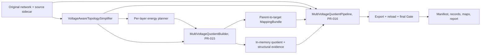

# ADR-008: Multi-voltage quotient construction and acceptance boundary

Status: proposed for review, 2026-10-29. This ADR is the design-only PR-014.
PR-015 implementation is blocked until this ADR is approved.

## Context and decision

The first phase can selectively simplify a voltage-aware network, but the
existing energy planners and PyPSA quotient materializer explicitly reject
Transformers and multiple nominal voltages. Phase 1.5 closes that structural
path without claiming AC power-flow, reactive-power, OPF, or control
equivalence. It keeps the existing single-voltage path and the public PyPSA
compatibility boundary in ADR-006.

Two APIs have separate ownership:

- **PR-015 `MultiVoltageQuotientBuilder`** is a pure in-memory transformation.
  It receives `simplified_network` and its authoritative `parent_sidecar`, a
  stable-ID partition, aggregation settings, protection, voltage aliases, and
  invariant specifications. It never writes files and never receives the raw
  original network. It returns a new network, mappings relative to its parent,
  target sidecar, records, and in-memory structural evidence.
- **PR-016 `MultiVoltageQuotientPipeline`** owns orchestration, source-input
  SHA-256 and semantic-signature checks, topology/quotient map composition,
  persistence, export/reload, final structural Gate, manifest, failure evidence,
  opportunity report, and CLI/report integration. Only this layer receives the
  original source network and sidecar. A successful in-memory Builder result is
  not a completed run.

No PyPSA, PyPSA-Earth, or VeraGrid source changes or monkey-patches are
permitted. All clustering calls use `network.cluster.spatial.*` through the
existing compatibility wrapper. Unsupported public API behavior causes a
typed capability failure; any private API would require its own ADR first.

## Data flow and stage ownership



The Builder's `VoltageLayerClassifier` classifies buses, the
`MultiVoltageBusmapValidator` checks target ownership and singleton rules,
the `LayerQuotientMaterializer` creates one quotient per layer, and the
`CrossLayerComponentReconnector` assembles one output network. The
`MultiVoltageStructuralValidator` checks both in-memory output in PR-015 and
the reloaded output in PR-016. The Pipeline composes the topology stage's
original-to-simplified maps with the Builder's simplified-to-final maps.

## Voltage layers, aliases, and supported components

`voltage_layers.aliases` is an explicit mapping from an exact finite positive
source `v_nom` value to a canonical finite positive nominal kV value. An empty
mapping is the default. Classification uses exact numeric equality after
normalizing equivalent representations such as `110` and `110.0`. There is no
implicit tolerance, rounding band, nearest-voltage selection, or silent
single-voltage flattening. Every alias application is recorded in the voltage
layer map with source and canonical voltage. Different source values can share
a layer only through a declared alias; the target Bus `v_nom` is that declared
canonical value. The alias is an explicit modeling assumption and does not
establish electrical equivalence. An alias that makes a Transformer's two
terminals belong to one layer or hides a cross-layer Line is rejected.

Each layer graph contains same-layer Bus and Line edges. Its partition domains
are intersections of nominal-voltage layer, original connected
component/subnetwork, and declared region. Transformers are interfaces between
layers, not ordinary cluster edges. A Transformer terminal is always a
mandatory singleton; its two mapped terminals must exist and differ. No
Transformer is removed or aggregated. A Line crossing layers fails preflight.
Same-layer, two-terminal Links may follow the existing quotient path if their
dynamic attributes and mapping are supported; cross-layer and multi-terminal
Links fail explicitly. The reconnection API has a component-handler registry,
but PR-015 registers only `Transformer`. `GlobalConstraint`, `Process`, unknown
custom components, unknown control references, and unsupported branch models
fail rather than being silently dropped. `Carrier`, `LineType`, and
`TransformerType` tables are copied completely when referenced; `SubNetwork`
is regenerated from the assembled topology and never copied as an identity
table.

## Cluster budget contract

For each layer and each independent partition domain, let `S` be all mandatory
singleton buses from Transformer interfaces, retained ring endpoints,
controlled devices, protection rules, and explicit singleton requirements.
Remove `S` from the same-layer Line graph. Let `F_1 ... F_m` be the connected
components of the resulting **free induced subgraph**. The structural minimum
is `|S| + m`, summed over the layer's subnetwork/region domains. This corrects
the simpler but unsafe floor of one cluster per original connected component.
`cannot_link` and other placement constraints can make the true feasible
minimum higher; the validator must reject a target or plan that cannot satisfy
them. No cluster spans a domain boundary or nominal-voltage layer.

`partition.target.n_clusters` is the requested global count. Optional
`partition.target.per_layer` maps canonical layer keys to exact integer target
counts. Every override must be within its layer's calculated floor and bus
count. The sum of overrides and unassigned floors must not exceed the global
target; the global target must not exceed the source bus count. After reserving
floors and overrides, distribute the remaining budget among unassigned layers
by largest remainder, weighted by their remaining capacity
`bus_count - structural_minimum`. Saturated layers are removed and the
remainder is redistributed. Equal remainders break ties by canonical layer
key. An explicit per-layer target is fixed, never silently adjusted.

Within each layer, K-means, HAC, or greedy modularity receives an explicit
seed. Connectivity policy is only `reject` or deterministic
`split_disconnected`. The Builder records requested and actual cluster counts
separately, globally and per layer. A repair can raise the actual count above
the requested count; it never rewrites the request.

## In-memory materialization and reconstruction

The Builder clones `simplified_network`. For each voltage layer it constructs
a public-API subnetwork, excluding Transformers and other cross-layer
components, then calls the existing PyPSA quotient through
`backends/pypsa/compat.py`. Global target IDs and PyPSA names include a
deterministic layer qualifier. It checks all per-layer results before
reassembly. The source object and `parent_sidecar` remain unchanged.

Reassembly creates a new network with the same snapshots, snapshot weightings,
investment periods, investment-period weightings, and all supported static and
dynamic attributes. Every time-series table is translated with the same name
registry used by static component rows. The exact snapshot and investment
indexes, order, weightings, and supported dynamic values are validated before
and after export/reload. An unknown populated dynamic attribute is a typed
failure, not a discarded column. A supported dynamic attribute whose
aggregation is unspecified also fails.

The `CrossLayerComponentReconnector` registry accepts a future handler
protocol for cross-layer component types. Its first registered handler copies
each Transformer once, reconnects its two original terminal buses through the
singleton busmap, and rejects a self-loop, missing endpoint, wrong layer,
type-reference mismatch, or name collision. Future Link handlers require a
separate design review; the registry's presence does not enable cross-layer
Links in this phase.

Transformer validation uses a canonical semantic hash of the **complete**
static Transformer row, every populated Transformer dynamic attribute and
snapshot, and all referenced `TransformerType` rows. It includes references
and their resolved types, not a fixed hand-picked electrical-field whitelist.
Canonicalization sorts component and attribute keys, preserves ordered
snapshot indexes, normalizes missing values and numeric representation, and
excludes only explicitly documented nonsemantic serialization metadata.
Compare hashes before construction, after in-memory reassembly, and after
NetCDF reload. A changed parameter, tap, control field, time series, or
referenced type fails the Gate. `Carrier` and `LineType` references receive
analogous existence and full-table checks.

## `AggregationInvariantSpec` and structural states

An `AggregationInvariantSpec` names a component type, an attribute, whether it
is static or dynamic, a snapshot selector for dynamic data, a grouping scope
(source component, original connected component/subnetwork, or global), and
an aggregation strategy such as `sum`, `preserve_exact`, or an explicitly
configured weighted rule. The Gate compares source and quotient values after
applying the relevant source-to-target device mapping and configured strategy.
For an additive injection, compare every selected snapshot within its
original connected component; do not infer conservation from network-wide
totals alone. Tolerances, if used for floating-point sums, are declared per
specification and recorded. Unsupported or unknown dynamic attributes fail
preflight. `AggregationInvariantSpec` replaces the ambiguous blanket phrase
"injection conservation"; a device or attribute absent from the supported
specification cannot acquire an implicit pass.

The only new quotient structural states are
`MULTI_VOLTAGE_QUOTIENT_STRUCTURALLY_VALID` and
`MULTI_VOLTAGE_QUOTIENT_STRUCTURALLY_INVALID`. PR-015 may produce an in-memory
preliminary structural result using these names, but only PR-016 may persist a
successful final state, after export, reload, map composition, and a second
Gate. Preflight or construction errors write `FAILED` plus
`validation/failure.json` through the Pipeline and return a nonzero CLI status.
A built result that fails a structural check writes the available maps and
evidence with `MULTI_VOLTAGE_QUOTIENT_STRUCTURALLY_INVALID`; it never reports
success. The existing single-voltage `STRUCTURALLY_VALID/INVALID` states stay
on their separate path. No state asserts AC PF, reactive-power, OPF, or full
grid physical acceptance.

## Mapping and topology guarantees

The authoritative `MappingBundle` remains stable-ID keyed and contains
`bus_map`, `branch_map`, `device_map`, and `control_map`. Read-only `line_map`
and `transformer_map` projections of `branch_map` are exported as separate
Parquet artifacts; they are not second editable truths. The target identity
sidecar is saved separately. Every simplified source Bus, supported branch,
device, and control has exactly one source row. Several source Lines may map
to one target Line, including parallel-line aggregation; the many-to-one
branch map is mandatory. A Line absorbed inside a cluster has
`mapping_type="absorbed_internal"` and no target Line. Transformer rows are
preserved one-to-one; no Transformer may be absorbed or aggregated.

L1 selective topology simplification keeps every protected cycle-edge
identity. L2 quotient defaults to a weaker, explicit guarantee: protected
cycle corridors, their singleton endpoints, and ring topology remain, while
individual L1 Line identities need not remain. The L2 Gate checks a mapped
cycle corridor and ring-topology predicate on the target multigraph; it does
not require an injective cycle-edge map. Parallel aggregation is allowed only
when that predicate still holds. A requested strict L1 edge-identity guarantee
at L2 is a separate, opt-in future contract.

The Gate checks each original connected component/subnetwork separately,
including its mapped target component and absence of accidental cross-source
connections. It does not require the whole source network to be connected.
Mandatory singleton and control ownership, all Transformer terminal and hash
checks, injection invariants, target existence, and source-ID coverage are
independent Gate checks.

Original-model immutability is established by SHA-256 of the input artifact
and a canonical semantic signature of its loaded network before and after the
Pipeline. It does not require byte-identical serialization of arbitrary
in-memory Python objects. The Pipeline retains the original source only for
this check and for composing original-to-final mappings; the Builder never
mutates or receives it.

## Public API target for review

All public methods receive type annotations, docstrings, and typed domain
exceptions. The following names and ownership are the review target; exact
dataclass field details can be finalized in PR-015 without expanding scope.

```python
class VoltageLayerClassifier:
    def classify(self, simplified_network: pypsa.Network,
                 parent_sidecar: IdentitySidecar,
                 aliases: Mapping[float, float]) -> tuple[VoltageLayer, ...]: ...

class MultiVoltageBusmapValidator:
    def validate(self, simplified_network: pypsa.Network,
                 parent_sidecar: IdentitySidecar, partition: PartitionPlan,
                 layers: tuple[VoltageLayer, ...],
                 protection: ProtectionSet) -> ValidatedLayerBusmaps: ...

class LayerQuotientMaterializer:
    def materialize(self, simplified_network: pypsa.Network,
                    parent_sidecar: IdentitySidecar,
                    busmaps: ValidatedLayerBusmaps,
                    aggregation: AggregationConfig) -> tuple[LayerQuotient, ...]: ...

class CrossLayerComponentReconnector:
    def register(self, component_type: str,
                 handler: CrossLayerHandler) -> None: ...
    def reconnect(self, simplified_network: pypsa.Network,
                  parent_sidecar: IdentitySidecar,
                  layers: tuple[LayerQuotient, ...],
                  busmaps: ValidatedLayerBusmaps) -> ReconnectedNetwork: ...

class MultiVoltageStructuralValidator:
    def validate(self, parent_network: pypsa.Network,
                 quotient_network: pypsa.Network,
                 parent_sidecar: IdentitySidecar,
                 target_sidecar: IdentitySidecar,
                 mappings: MappingBundle,
                 invariants: tuple[AggregationInvariantSpec, ...],
                 protection: ProtectionSet) -> MultiVoltageStructuralResult: ...

class MultiVoltageQuotientBuilder:
    def build(self, simplified_network: pypsa.Network,
              parent_sidecar: IdentitySidecar, partition: PartitionPlan,
              aggregation: AggregationConfig, protection: ProtectionSet,
              voltage_aliases: Mapping[float, float],
              invariants: tuple[AggregationInvariantSpec, ...]
              ) -> MultiVoltageBuildResult: ...

class MultiVoltageQuotientPipeline:
    def run(self, original_network: pypsa.Network,
            source_sidecar: IdentitySidecar,
            config: ReductionConfig,
            store: ArtifactStore) -> MultiVoltagePipelineResult: ...
```

`MultiVoltageBuildResult` contains the detached network, target sidecar,
parent-to-target `MappingBundle`, one `ReductionRecord` per layer and one for
reconnection, per-layer requested/actual cluster counts, and preliminary
structural evidence. `MultiVoltagePipelineResult` identifies the reloaded
network artifact, original-to-final maps, final structural evidence, manifest,
and `CompressionOpportunityReport`. The Builder's records have in-memory
semantic parent/child signatures; the Pipeline fills persisted artifact hashes
when writing stage records. No record claims a file hash before a file exists.

## Test matrix and PR boundaries

| PR | Programmatic offline fixture and required assertion |
| --- | --- |
| PR-013 | Isolated sdist/wheel build; archive members and resources; fresh venv installs the built wheel with binary dependencies; installed CLI `--help`, `validate-config`, `dump-schema`, `report`; generated `test_summary.json`. |
| PR-015 classification | Three exact voltages, explicit aliases, invalid/NaN/zero values, cross-layer Line and alias-induced Transformer collapse. No implicit tolerance. |
| PR-015 allocation | Singleton-removal splits a free graph into multiple components; multi-subnetwork and region domains; `cannot_link`; global floor, largest remainder ties/capacity, valid and invalid `per_layer` overrides. |
| PR-015 Builder | Three-layer quotient, Transformer singleton terminals, full static/dynamic/type hash, same-layer Link support and cross-layer Link failure, no self-loop, no original mutation, deterministic output. |
| PR-015 mapping/Gate | Parallel Lines map many-to-one; absorbed internal Line has no target; L1 cycle IDs and L2 corridor/ring predicate; disconnected source components remain distinct; per-component/snapshot aggregation invariants; unknown dynamic attribute fails. |
| PR-016 persistence | Snapshots, both weighting tables, investment periods, supported dynamic data and type references survive export/reload; `SubNetwork` regenerated; target sidecar resolves every target ID. |
| PR-016 end to end | Original three-voltage network to topology, seeded energy planner, Builder, composed maps, final Gate and report; PV/shunt/tap/remote-control protection; deterministic rerun; failed busmap, unsupported component, corrupted reload and input mutation produce typed failure evidence. |

`test_summary.json` is generated by the PR-013 build Gate and is **not** a
checked-in static truth. Phase 1.5 tests use programmatic PyPSA networks and
do not include VeraGrid-to-PyPSA conversion or internet access. The
`CompressionOpportunityReport` records ring, Transformer and control endpoint
counts, radial-tree and series opportunities, rejection reasons, and
theoretical versus realized bus compression; its theoretical figure is a
structural upper bound, not a physical-equivalence promise.

Non-goals: Ward, Kron, PTDF, Di-Shi, AFDPF-R, full-grid PF verification,
state/control lifting, OPF, UC, GNN, and `lift_to_target_voltage`.
