# Adaptive Reduction Contracts

## Status and scope

This document freezes the design contract for PR-023A. It defines architecture, data contracts, state transitions, replay requirements, and the next synthetic acceptance plan. It does not implement the adaptive controller.

PR-023A operates only on **REDUCTION_FIDELITY**: comparison of one frozen PyPSA S1 model with deterministic reduced candidates derived from that S1 model. The independent terms **STRUCTURAL_VALIDITY**, **AC_MODEL_READINESS**, **PF_EXECUTION**, **REDUCTION_FIDELITY**, **PROJECTION_FIDELITY**, and **PHYSICAL_EQUIVALENCE** retain the meanings in the [0.5.0 baseline](../validation/2026-11-01-psdcalc-reduction-0.5.0-baseline.md). PR-023A does not address projection fidelity and does not claim physical equivalence.

Out of scope: ML, GNN, UMAP, reinforcement learning, OPF, VAR optimization, time-series PF, N-1, source projection fidelity, VeraGrid fidelity, redispatch, control retuning, and changes to the frozen PR-022 threshold definition.

## Goal and invariant

The future objective is to minimize reduced network size subject to the frozen hard fidelity constraints and any configured compression requirement. The first implementation is a deterministic heuristic; it does not solve or certify the global optimization problem.

Every candidate is rebuilt from S1:

```text
candidate_k = build(S1, active_actions_k, frozen_reduction_config)
```

It is not produced by patching candidate `k-1` in place. S1, its operating point, solver contract, metric policy and threshold artifact are immutable inputs to the adaptive run.

## Data flow

```mermaid
flowchart LR
  accTitle: Adaptive reduction iteration flow
  accDescr: A frozen S1 network generates a reduced candidate, which passes structural and readiness checks before PF and fidelity analysis. Error attribution proposes legal local expansions, and every new candidate is rebuilt from S1. Reports and replay evidence bind each iteration.
  A["Frozen S1 + sidecar"] --> B["Initial reduction actions"]
  B --> C["Candidate builder from S1"]
  C --> D["STRUCTURAL_VALIDITY"]
  D --> E["AC_MODEL_READINESS"]
  E --> F["PF_EXECUTION"]
  F --> G["REDUCTION_FIDELITY metrics"]
  G --> H["Error attribution"]
  H --> I["Legal expansion candidates"]
  I --> J["Deterministic candidate scoring"]
  J --> C
  G --> K["Adaptive report and replay evidence"]
  J --> K
```



The controller orchestrates existing structural, readiness, PF, mapping and metric contracts. It does not duplicate PF metric calculations or bypass the MappingBundle.

## Public concepts

The following are design-level public concepts. A later implementation may use repository naming conventions while preserving their semantics. Public contracts must contain stable identities and serializable values, never backend-specific PyPSA objects.

| Concept | Contract |
|---|---|
| `AdaptiveReductionConfig` | Frozen reference to the starting reduction config, operating-point contract, executor contract, metric policy, threshold artifact/digest, optional compression requirement, strategy name, cost weights and maximum iteration count. It cannot override PR-022 threshold values. |
| `AdaptiveReductionState` | Immutable current iteration index, active action IDs, candidate evidence references and terminal state, if any. It does not hold a mutable network object. |
| `AdaptiveReductionIteration` | One immutable record of candidate action-set fingerprint, build/Gate/PF/fidelity results, attribution, candidate evaluations, selected expansion and stopping reason. |
| `ReductionAction` | Stable, replayable description of one supported reduction operation and its source/target/mapping effects, dependencies, protection context and reversibility. |
| `ReductionActionJournal` | Immutable catalog of reduction actions plus ordered immutable action-set versions/deltas used by candidates. |
| `ErrorAttribution` | Metric-level discrepancy, threshold class, normalized violation, source/target identities, attribution status and related regions/candidates. |
| `ErrorRegion` | Deterministic topological grouping of source/target identities, layer, component, cluster/corridor/cutset context and related action dependencies. |
| `ExpansionCandidate` | A legal dependency-closed set of currently active reduction actions to deactivate, plus deterministic fingerprint and estimated expansion cost. |
| `ExpansionDecision` | Evaluated candidate scores, chosen candidate, tie-break trace and reason. |
| `AdaptiveStoppingReason` | Mutually exclusive terminal result defined below. |
| `AdaptiveReductionReport` | Run-level summary and ordered iteration records with references to replayable evidence. |

## ReductionAction and reversibility

A `ReductionAction` must identify:

- action ID and canonical fingerprint;
- operation type: `RADIAL_ABSORPTION`, `BUS_CLUSTER`, `PARALLEL_CORRIDOR_AGGREGATION`, or `OTHER_SUPPORTED_REDUCTION`;
- source object StableIds;
- target object StableIds produced or affected;
- operation parameters needed to rebuild from S1;
- mapping delta, expressed through existing MappingBundle contracts;
- applicable protection reasons and whether the action is eligible for adaptive expansion;
- component, canonical voltage layer and owning ErrorRegion;
- dependencies that must be reversed together;
- parent/child action relations;
- reversibility declaration and exact inverse semantics;
- deterministic audit reason.

An action is admissible only if the existing reduction pipeline can reproduce its effect from S1 and authoritative sidecar data. `OTHER_SUPPORTED_REDUCTION` is not permission to invent new operations; each concrete operation must be supported and versioned. Unsupported or incompletely described operations fail closed.

The action fingerprint is computed from a canonical payload with sorted StableIds, canonical operation parameters, mapping delta, dependency IDs, protection context, and schema/version. It must not depend on dataframe row order, backend names, memory addresses, runtime, or random iteration order.

Protected objects remain protected. An action touching a protected object is either absent from the action catalog or marked ineligible; it cannot become a normal expansion candidate.

## Immutable ReductionActionJournal

The journal contains an immutable action catalog and an ordered series of immutable active-action-set snapshots. “Active” means the reduction action is applied when rebuilding a candidate. Expansion deactivates one action together with all required dependent actions; it does not mutate or delete journal history.

For each iteration, the journal records:

- parent action-set fingerprint;
- ordered deactivation delta;
- resulting sorted active action IDs;
- dependency closure applied;
- mapping delta/fingerprint;
- audit reason and decision reference.

Replay is defined by:

```text
candidate_k =
build(
  frozen_S1,
  journal.active_actions(k),
  frozen_reduction_config
)
```

The result must bind the S1 model digest, sidecar digest, config digest, action catalog digest, action-set fingerprint and resulting MappingBundle digest. Candidate generation must be deterministic for the same bound inputs.

## ErrorAttribution and ErrorRegion

Attribution reuses the existing PR-022 metric implementation and policy. It must not create a second definition for Bus Vm, Bus angle, branch P/Q, cutset P/Q, injection or passive-loss metrics.

Each attribution entry identifies:

- metric and compared quantity;
- observed discrepancy and its units;
- applicable HARD or diagnostic classification from the frozen policy;
- resolved threshold and normalized HARD violation;
- mapped source and target StableIds;
- one or more legal ErrorRegions, or an explicit unattributable reason;
- candidate action IDs that could legally affect the region.

Required attribution families:

| Fidelity quantity | Attribution identity/context |
|---|---|
| Bus Vm and angle | mapped source/target Bus, source membership of target Bus cluster, voltage layer and component |
| Branch P and Q | mapped source/target branch, corridor and endpoint clusters |
| Cutset P and Q | named/mapped cutset boundary and its incident regions |
| Cluster net injection | source Bus membership and associated devices, preserving existing injection metric semantics |
| Passive loss | mapped branches/corridors and the connected component contributing to the metric |

A HARD violation that cannot be assigned to any legal expansion candidate is terminal `UNATTRIBUTABLE_HARD_VIOLATION`. It must not be discarded, downgraded, or treated as diagnostic. Diagnostic-only metrics may be recorded but cannot drive acceptance or override a HARD violation.

ErrorRegion construction is deterministic and uses existing graph topology and StableIds. Allowed grouping dimensions are connected component, canonical voltage layer, target Bus cluster, source Bus membership, cutset boundary, branch corridor and action dependency relations. Statistical clustering and learned embeddings are excluded.

## Expansion candidates and deterministic strategy

The first strategy is `HIERARCHICALLY_CONSTRAINED_GREEDY_LOCAL_EXPANSION`.

Candidate generation may only deactivate existing supported reduction actions. It may not redispatch generators, change voltage setpoints or taps, switch shunts, modify loads, mutate S1, relax thresholds, or alter solver settings. Every candidate is dependency-closed and rebuilt from the same S1.

Candidate evaluation order:

1. Construct a deterministic candidate set from attributed HARD violations and legal action dependencies.
2. Sort candidates by canonical candidate fingerprint before evaluation.
3. Rebuild each candidate from S1 and run the same structural Gate, AC readiness, PF executor and fidelity metric policy.
4. Mark a candidate ineligible for scoring if structural validation fails, AC readiness fails, PF does not converge, or it violates an invariant.
5. For eligible candidates, compute the measured reduction in normalized HARD-threshold violation divided by expansion cost. If no HARD violation remains, the candidate is fidelity-feasible; it is not considered better merely because diagnostic values changed.
6. Select by descending normalized violation reduction per cost, then ascending added Bus count, ascending added branch count, region fingerprint, and sorted action StableIds.
7. Persist all evaluated candidate outcomes and the exact tie-break trace.

The initial cost is a configured deterministic weighted sum of additional Bus count and additional branch count; both weights must be finite and positive and the resulting cost must be non-negative. For positive cost, score is the measured normalized HARD-violation reduction divided by that cost. For zero-cost candidates, positive-reduction candidates rank ahead of every positive-cost candidate and are ordered by descending reduction, then the ordinary tie-break fields; zero-reduction candidates are ineligible while a HARD violation remains. This rule is finite and never divides by zero. A candidate with no measured HARD-violation reduction is not selected while a HARD violation remains.

This is a deterministic local heuristic. It makes no global optimality claim and may stop without finding a feasible candidate.

## State machine and terminal reasons

Nonterminal stages are: `INITIALIZE`, `BUILD_CANDIDATE`, `STRUCTURAL_CHECK`, `AC_READINESS_CHECK`, `PF_EXECUTION`, `FIDELITY_EVALUATION`, `ERROR_ATTRIBUTION`, `CANDIDATE_GENERATION`, `CANDIDATE_EVALUATION`, and `DECISION`.

Exactly one terminal reason is recorded:

| Terminal reason | Meaning | Acceptance |
|---|---|---|
| `FIDELITY_SATISFIED` | All HARD preregistered fidelity constraints pass and no configured compression objective remains unmet. | Success |
| `FIDELITY_SATISFIED_BUT_COMPRESSION_BUDGET_NOT_MET` | Fidelity passes, but a configured compression objective/budget does not. | Not accepted |
| `NO_EXPANSION_CANDIDATE` | A HARD violation remains, and candidate generation produces zero legal expansion candidates before candidate evaluation begins. This reason means exactly that the legal candidate set is empty. | Not accepted |
| `NO_VIABLE_EXPANSION_CANDIDATE` | A non-empty legal expansion candidate set was generated, but every evaluated candidate was rejected by a candidate-level prerequisite Gate before becoming a viable scored expansion. Rejections may be from structural validity, AC model readiness, or PF execution; each reason is retained per candidate. | Not accepted |
| `UNATTRIBUTABLE_HARD_VIOLATION` | At least one HARD violation cannot be mapped to a legal expansion candidate. | Not accepted |
| `STRUCTURAL_INVALID` | The required current candidate fails the structural Gate before expansion-candidate generation. | Not accepted |
| `AC_MODEL_NOT_READY` | The required current candidate fails AC model readiness before expansion-candidate generation. | Not accepted |
| `PF_NOT_CONVERGED` | The required current candidate PF does not converge under the frozen executor contract before expansion-candidate generation. | Not accepted |
| `MAX_ITERATIONS_REACHED` | The current iteration has completed without acceptance and the configured iteration limit prevents another iteration from starting. | Not accepted |
| `NO_FURTHER_COMPRESSION_BENEFIT` | A non-empty legal candidate set was generated and at least one candidate passed structural validity, AC model readiness, and PF execution and reached fidelity evaluation/scoring. The configured bounded search is exhausted, but no viable candidate provided sufficient HARD-violation reduction. This heuristic result is not proof of infeasibility, global optimality, or absence of a better reduction. | Not accepted |
| `CONFIGURATION_INVALID` | Configuration, referenced evidence, threshold binding, or required contracts are invalid. | Not accepted |

A result is accepted only if every HARD preregistered threshold passes and any configured compression requirement is met. Diagnostic metrics remain diagnostic. Structural validity, AC readiness, PF execution and reduction fidelity remain independent fields in every report.

Terminal reasons are mutually exclusive run-level outcomes. Apply this decision order at the end of each completed iteration:

1. If configuration or bound evidence is invalid, return `CONFIGURATION_INVALID`.
2. If the required current candidate failed its structural, readiness, or PF Gate before expansion generation, return `STRUCTURAL_INVALID`, `AC_MODEL_NOT_READY`, or `PF_NOT_CONVERGED`, respectively.
3. If a HARD violation is unattributable to any legal expansion, return `UNATTRIBUTABLE_HARD_VIOLATION`.
4. If fidelity passes but the configured compression requirement remains unmet, return `FIDELITY_SATISFIED_BUT_COMPRESSION_BUDGET_NOT_MET`.
5. If fidelity and all configured objectives pass, return `FIDELITY_SATISFIED`.
6. If the legal candidate set is empty before evaluation, return `NO_EXPANSION_CANDIDATE`.
7. If the legal candidate set is non-empty but no candidate passes the prerequisite structural, readiness, and PF Gates, return `NO_VIABLE_EXPANSION_CANDIDATE`. This applies both when candidates fail the same Gate and when they fail different Gates; do not promote a candidate-level failure to the run-level reason.
8. If at least one candidate reaches fidelity evaluation/scoring, all remaining candidate paths within the configured bound have been evaluated, and none provides sufficient HARD-violation improvement, return `NO_FURTHER_COMPRESSION_BENEFIT`. If a scored candidate provides improvement and another iteration remains, continue with that selected expansion instead of terminating here.
9. Otherwise, if the completed iteration count has reached `max_iterations` and another iteration would be required, return `MAX_ITERATIONS_REACHED`. The limit is checked after evaluating the completed iteration and before starting a new one; success or another terminal condition established by that completed iteration takes precedence.

Every generated candidate has its own evaluation record containing candidate fingerprint, structural Gate result, AC readiness result, PF execution result, fidelity result when reached, rejection reason, and score when reached. A stage skipped because an earlier prerequisite failed is recorded as `NOT_RUN` with its dependency reason. Thus `NO_VIABLE_EXPANSION_CANDIDATE` never hides which prerequisite Gate rejected each candidate. A candidate-level structural/readiness/PF failure does not terminate the run while another candidate remains viable. A fidelity-passing incumbent that misses a configured compression requirement always uses `FIDELITY_SATISFIED_BUT_COMPRESSION_BUDGET_NOT_MET`.

## Evidence and replay

The future `AdaptiveReductionEvidenceStore` binds the following for every iteration:

- iteration index and parent iteration;
- S1 model and sidecar digests;
- frozen reduction/adaptive configuration digests;
- action catalog digest and active-action-set fingerprint;
- candidate model digest and MappingBundle digest;
- structural report digest and status;
- AC readiness report digest and status;
- PF execution status and bound operating-point/executor digests;
- fidelity report digest and frozen threshold digest;
- error-attribution digest;
- sorted candidate-set digest;
- chosen expansion action set and score;
- terminal stopping reason, if any.

Replay reloads the persisted S1, sidecar, action journal, candidate mappings and reports; verifies actual payloads against their digests; rebuilds each candidate from S1; and independently rechecks model, map, Gate, PF and fidelity evidence. Stored digest strings alone are never authoritative. Runtime is diagnostic and excluded from semantic fingerprints and determinism comparisons.

Tampered action records, missing source identities, invalid dependency closure, cross-run artifact substitution, report digest mismatch or candidate rebuild mismatch fail closed with an explicit evidence-integrity error.

## PR-024A synthetic acceptance plan

No tests are implemented by this design PR. PR-024A must use offline programmatic PyPSA fixtures for at least these cases:

| Fixture | Required assertion |
|---|---|
| Terminal A. Empty candidate set | Candidate generation returns no legal expansion; run stops with `NO_EXPANSION_CANDIDATE` before candidate evaluation. |
| Terminal B. No viable candidate | A non-empty set is generated and every candidate fails a prerequisite structural, readiness, or PF Gate; run stops with `NO_VIABLE_EXPANSION_CANDIDATE`. |
| Terminal C. No sufficient improvement | At least one candidate passes prerequisite Gates and reaches fidelity scoring; the bounded alternatives are exhausted, but none sufficiently reduces the remaining HARD violation; run stops with `NO_FURTHER_COMPRESSION_BENEFIT`. |
| Terminal D. Mixed prerequisite failures | Three candidates fail respectively structural validity, AC readiness, and PF execution; run stops with `NO_VIABLE_EXPANSION_CANDIDATE` and preserves all three candidate-level reasons. |
| Local voltage correction | Restoring one legal region action fixes the HARD voltage violation; selected sequence is reproducible. |
| Branch/cutset corridor restoration | Restoring a corridor action improves the mapped branch or cutset violation and is attributed to that corridor. |
| Deterministic tie-break | Two equal-scoring candidates resolve by declared cost, region fingerprint and StableId ordering. |
| Protected-object exclusion | Protected action cannot enter the eligible expansion candidate set. |
| Unattributable HARD violation | Run stops with `UNATTRIBUTABLE_HARD_VIOLATION`; no silent downgrade. |
| Structural-invalid expansion | Candidate Gate failure is recorded and excluded from scoring; if all non-empty candidates fail prerequisite Gates, use `NO_VIABLE_EXPANSION_CANDIDATE`. |
| AC-not-ready expansion | Readiness failure is persisted and the candidate is never sent to PF; if all candidates fail prerequisite Gates, use `NO_VIABLE_EXPANSION_CANDIDATE`. |
| PF non-convergence | Non-convergence is preserved per candidate; if all candidates fail prerequisite Gates, use `NO_VIABLE_EXPANSION_CANDIDATE`. |
| Iteration bound | Thresholds not reached before another iteration may start produce `MAX_ITERATIONS_REACHED`; the just-completed iteration is evaluated first. |
| Journal replay | Replay reconstructs the exact candidate/action-set sequence and mapping digests. |
| Tampered journal | Changed action payload, dependency or mapping delta fails closed. |
| Equivalent starting config | Same S1, config, thresholds and seed-independent deterministic inputs yield the same chosen sequence. |

The test plan also covers a mixed connected-component/multi-voltage fixture, aggregation cost accounting, dependency-closed reversal, diagnostic-only metrics, threshold provenance immutability, and original S1 semantic immutability.

## PR-025A Beijing experiment plan

Design only; no Beijing input is read or executed by this PR.

Before the experiment, freeze and publish: starting reduction policy/candidate, source S1 digest, operating-point contract, PyPSA executor and version, metric policy, threshold artifact and digest, adaptive strategy, iteration limit, cost function/weights, candidate ordering and tie-break rules.

For each iteration report candidate Bus/Line inventories, active reduction-action count and fingerprint, structural/readiness/PF statuses, every HARD violation, diagnostic metrics separately, evaluated candidate scores, selected expansion and added Bus/branch cost. The final summary reports iteration count, final compression, final fidelity status, stopping reason and diagnostic runtime.

The evidence must be separate from PR-022 artifacts. No threshold, operating point, solver option or structural Gate may be changed in response to Beijing results. A nonconvergent candidate is not a fidelity pass or a speedup result.

## Explicit non-goals

This design does not implement an adaptive controller, candidate mutation engine, source projection pipeline, ML/GNN/UMAP, reinforcement learning, OPF, VAR optimization, time-series PF, N-1 checks, VeraGrid PF, or physical equivalence. It does not alter PR-022 thresholds or historical evidence.
