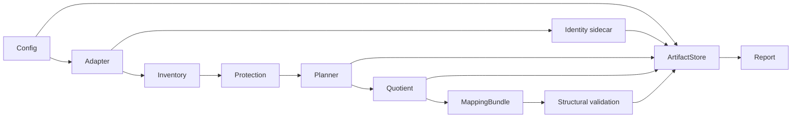

# PSDCalc Reduction 第一批修订设计（PR-001 至 PR-010）

日期：2026-10-29。状态：经用户总体批准并按 12 项审查意见修订；实现范围限第一批。

## 目标与边界

输入 PyPSA 网络，经严格配置、清单与保护、custom busmap、PyPSA quotient materializer，输出网络、外部身份表、bus/line/device 映射、操作记录、运行 manifest 和结构报告。公共基础链的 Gate 结果只允许 `STRUCTURALLY_VALID` 或 `STRUCTURALLY_INVALID`。在此链完成后，第一期增加电压感知、环网保持的选择性拓扑简化，然后再接入 K-means/HAC/modularity 能源聚类。任何阶段均不产生完整网物理可行性或接受结论。

除下文限定的 `VoltageAwareTopologySimplifier` 外，不实现通用 simplification transforms、多层 hierarchy/replay、PyPSA-Earth 工作流、VeraGrid adapter/Ward、潮流精度验收、AFDPF-R、回代、局部展开、OPF、UC、GNN。不得修改 PyPSA、PyPSA-Earth、VeraGrid 源码或 monkey-patch。

## 仓库事实与技术选择

现有 VeraGrid 缩减代码在 `src/VeraGridEngine/Topology/GridReduction/`，与本包隔离。`src/VeraGridEngine/PSDCalc/` 当前以文档为主。根 `setup.py` 是文档元数据包装；新项目设于 `packages/psdcalc-reduction/`，使用标准 `src/psdcalc/reduction/` 布局与包内 `tests/`。现有 `.venv` 缺 PyPSA、Pydantic、Hypothesis 等，安装和测试需要独立环境。工作区已有用户改动，提交时只暂存本批路径。

锁定 Python 与 PyPSA 受测版本，通过 `uv.lock` 保存完整依赖解析。聚类全部经单一 `backends/pypsa/compat.py` 调用 `network.cluster.spatial.*` 公开 accessor；若版本没有所需公开能力，抛 `BackendCapabilityError`，不调用私有 API。版本和具体公开签名应在实现时用锁定版本的测试确认。

## 数据流与责任

原始 `pypsa.Network` 不修改；先复制或从原始 artifact 重新读取，在副本上工作。外部 identity sidecar 以 `(namespace, component, source_key)` 为权威，关联 PyPSA 组件名称与 StableId；自定义 `source_id` 列仅为便捷镜像，NetCDF/CSV 回读以 sidecar 校验，不依赖该列持久化。Sidecar、输入文件 SHA-256、按稳定 ID 排序的拓扑签名和输出哈希写入 manifest。原子写入临时文件后替换；失败时记录阶段、异常类型、消息和已有 artifact 引用，并抛显式异常。

保护动作分为 `trace_only`、`preserve_component_identity`、`preserve_terminal_bus`、`preserve_bus_as_singleton`、`cannot_link`。冲突由 ProtectionEngine 在规划前拒绝；禁止隐式弱化规则。按额定电压层分别构图，Transformer 是层间接口，不参与普通同层 cluster。核对本地 PyPSA 源码后确认现有商图路径不会直接保留 Transformer；因此公共基础链的 quotient `build` 对含 Transformer 的网络报 `BackendCapabilityError`，不能静默丢弃。后续选择性简化器的默认 `keep_transformer_interface` 路径须保留 Transformer 与原电压侧端子；在其材料化和结构 Gate 能安全验证以前，同样显式失败。无 Transformer 的多电压网络不得跨电压簇聚类。

连通策略仅 `reject` 或确定性 `split_disconnected`。对每个源 connected component/subnetwork 独立检查，不要求整个输入网络单连通。拆分后记录 `requested_cluster_count` 和 `actual_cluster_count`，两者允许不同。线路映射有 `preserved`、`aggregated`、`absorbed_internal` 等类型；内部吸收线路的 `target_id` 可空，必须保留来源 ID、操作 ID 与吸收原因。设备映射同样记录保留或聚合归属。组合映射不以数组下标为持久键。

## 配置契约

Pydantic v2 所有模型使用 `extra="forbid"`，导出 JSON Schema。配置合并次序为内置 profile、项目配置、场景覆盖、CLI 覆盖，再语义校验。三类错误：`ConfigSchemaError` 表示类型、枚举、未知字段与 schema 版本错误；`UnsupportedFeatureError` 表示已知未来功能被启用；`ConfigSemanticError` 表示字段间矛盾或网络约束无法满足。禁用的未来字段允许解析并保留在 resolved config；启用即失败。YAML 不执行表达式。

| 分组 | 第一批字段和校验 |
| --- | --- |
| `schema_version` | 固定 `0.1.0`；版本迁移接口保留但不猜测迁移 |
| `run` | `id`, `seed`, `deterministic`, `output_dir`；随机 planner 必须显式 seed |
| `input` | `backend=pypsa`, `path`, `format=netcdf/csv`, `source_namespace` |
| `task` | `type`, `profile`, `reduction_role`, `final_authority`；只影响保护和报告，不能赋予物理接受状态 |
| `pipeline` | 本批仅单层、从 original 物化；启用 hierarchy/parent 模式报 `UnsupportedFeatureError` |
| `simplification` | 已知 operations 可解析；公共基础链阶段任何 enabled transform 报 `UnsupportedFeatureError`；后续仅开放 `voltage_aware_topology`，默认 `keep_transformer_interface`，规划 profile 才可使用 `lift_to_target_voltage` |
| `protection` | 声明式 rules：`id/component/match/ids_file/action`；五种 action 白名单 |
| `partition` | `planner=custom_busmap/pypsa_kmeans/pypsa_hac/pypsa_modularity`, `target`, `connectivity_policy=reject/split_disconnected`, cluster size, custom path, 受限 options |
| `aggregation` | `backend=pypsa`, `aggregate_one_ports`, preserve component list, line length factor, generator/one-port/line strategies；不支持的策略明确失败 |
| `mapping` | Parquet、完整 busmap、sidecar 身份、device/control ownership；未来 ownership 类型可声明但本批不能声称控制回代 |
| `validation` | 本批只运行 structural；启用 full-grid/acceptance 执行报 `UnsupportedFeatureError` |
| `equivalence/lifting/refinement` | 禁用配置可解析；启用报 `UnsupportedFeatureError` |
| `output` | 原始快照、网络、maps、records、结构 evidence；未来指标输出若需后续计算则启用时报错 |
| `features/plugins/cost_accounting` | 本批只允许 planner 所需公开特征与禁用插件；后续功能启用时报错 |

内置 profile 可命名为 `planning_aggregation`、`ac_pf_strict`、`var_control_strict`、`ac_opf_warmstart`、`dc_security_screening`、`custom`。只允许第一批能力实际运行；profile 内启用后续能力时及早失败。附带可运行的第一批 YAML；主设计的 `reduction.example.yaml` 不直接作为可运行测试，因为它启用了多层、简化与完整网验证。

## 文件与增量清单

| PR | 新增文件与职责 |
| --- | --- |
| 001 | `packages/psdcalc-reduction/pyproject.toml`, `uv.lock`, `src/psdcalc/__init__.py`, `src/psdcalc/reduction/{__init__,exceptions}.py`, `src/psdcalc/reduction/backends/pypsa/compat.py`, `tests/test_compat.py`；`docs/adr/001-006-*.md` 记录术语、只读、sidecar ID、物理裁决、后端边界、公开 PyPSA API |
| 002 | `config/{models,loader,profiles,schema_export}.py`, `schema/reduction.schema.json`, `examples/reduction.first-batch.yaml`, `tests/test_config.py` |
| 003 | `core/{artifact_store,manifests,records}.py`, `tests/test_artifacts.py` |
| 004 | `core/{ids,signatures,inventory}.py`, `tests/test_identity.py` |
| 005 | `backends/base.py`, `tests/test_backend_protocol.py` |
| 006 | `backends/pypsa/{adapter,import_export}.py`, `tests/test_pypsa_roundtrip.py` |
| 007 | `protection/{engine,selectors,rules}.py`, `tests/test_protection.py` |
| 008 | `planners/{base,custom_busmap}.py`, `tests/test_custom_busmap.py`；先交付自定义映射 |
| 009 | `materializers/quotient.py`, `tests/test_quotient.py` |
| 010 | `mapping/{bundle,compose,validation}.py`, `validation/structural.py`, `report.py`, `cli.py`, `tests/test_mapping.py`, `tests/test_structural.py`, `tests/test_cli.py` |
| 011 | `transforms/voltage_aware_topology.py`, `transforms/topology_roles.py`, `tests/test_voltage_aware_topology.py`；选择性简化及每步 ReductionRecord |
| 012 | `features/{load_generation,renewable_time}.py`, `planners/{kmeans,hac,modularity}.py`, `tests/test_energy_planners.py`；在简化器后运行能源聚类 |

CLI 命令 `validate-config`, `inspect`, `plan`, `build`, `report` 随所属能力接通。PR-010 的 report 只输出 `STRUCTURALLY_VALID/INVALID` 及理由。PR-011 的简化操作状态为 `STRUCTURALLY_SIMPLIFIED`，规划升压路径另标 `PLANNING_APPROXIMATION`；两者都不是物理接受状态。每个 PR 单独提交且只含其职责文件；所有 public API 有类型注解、docstring 和显式异常。

## 测试矩阵与交付门槛

| 类别 | 断言 |
| --- | --- |
| 配置 | 未知字段、错误类型、三个异常类别；禁用未来字段通过、启用未来字段失败；profile 合并次序 |
| 身份与可重放 | sidecar 跨 NetCDF/CSV 回读；StableId 无碰撞；输入哈希与拓扑签名重复；同 seed 相同映射；原模型前后不变 |
| 保护与 capability | 五种 action；多电压等级不跨层；transformer 约束；无坐标 K-means；保护与簇数冲突 |
| 连通性 | 多个原始 connected component 允许；`reject` 失败；`split_disconnected` 确定且 requested/actual cluster 数分记 |
| 映射 | 每个 source bus 恰映射一次；`absorbed_internal` 无目标线路合法；设备归属、无悬空端子、映射组合结合律 |
| PyPSA 集成 | 程序化小网络覆盖四 planner、quotient、导出回读与结构报告；另以静态声明的 IEEE 14 PyPSA 夹具做端到端小算例，注明数据来源，不引入 VeraGrid→PyPSA 转换代码 |
| 故障 | 无效 busmap、缺失 sidecar、导出异常、unsupported component；manifest/evidence 落盘且 CLI 非零退出 |
| 电压感知拓扑 | 分电压层图；2-core、bridge、articulation point、cycle-edge 分类；环网边不删除；单接口径向树和无注入串联链才可压缩；多边界、控制、内部环网、跨区域、复杂支路候选保留或失败 |
| 简化结构 Gate | 环网骨架、Transformer、控制设备、原 connected component、注入守恒、原模型哈希不变；电压层映射、角色、锚点、吸收支路、迁移设备和逐步记录完整 |

测试不访问互联网。第一批以程序化 PyPSA 小网络为主；IEEE 14 夹具直接声明 PyPSA 组件及参考参数，测试只验证构造、映射和结构，不声称完成 IEEE 14/39/118 PF gate。安装及锁定版本测试由 PR-001 开始实施。

## 风险与暂缓项

PyPSA 公开 API 随版本演变，wrapper 必须以锁定版集成测试确认。聚合输出的 line/device 可追溯性需要显式验证，不能仅凭名称推断。多电压和 transformer 可能使目标簇数不可达，应失败或按确定性拆分记录实际数。结构有效不代表潮流收敛、数值精度或完整网物理可行。

## 2026-10-29 第一期开拓补充：选择性拓扑简化

`VoltageAwareTopologySimplifier` 在公共基础链完成后、能源 K-means/HAC 前运行。每个 `v_nom` 层独立构图，Transformer 只作层间接口。用 2-core、bridge、articulation point 和 cycle-edge 标记环网骨架；一期不删除受保护环网边。仅单接口径向树、且无受保护设备或控制的区域，以及满足无注入、无控制、同层同区域条件的串联链可作为压缩候选。对多边界、内部环网、跨区域、复杂支路模型的候选，保留原状或显式失败，不能偷偷迁移设备。

默认 `keep_transformer_interface`，低压设备留在原电压侧。`lift_to_target_voltage` 仅作为 `planning_aggregation` 的显式规划近似选项，结果须标记 `PLANNING_APPROXIMATION`，并记录被迁移设备与电压层映射；不得把它称为 AC/无功/OPF 等值。每步写 `ReductionRecord`，包括拓扑角色、锚点、被吸收支路、设备迁移与哈希。结构 Gate 验证原环网骨架、Transformer、控制设备、连通分量、注入守恒和原模型不可变；通过简化步骤只声明 `STRUCTURALLY_SIMPLIFIED`。
