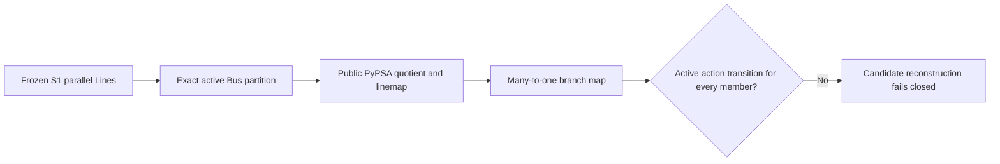

# PR-025 Stage2B candidate reconstruction RCA

_Anonymous diagnostic report, 2026-11-02. The authoritative Stage2B attempt remains stopped at candidate reconstruction._

---

## 🔎 Evidence and boundary

The [execution stop record](2026-11-02-pr025-stage2b-execution.md) was committed before this audit. Its private failure manifest has SHA-256 `11a14e961fc7ccc86aa4012491bef470da803263a8d78c2b8b09e5f86b78a471`. A deterministic reconstruction of the same 125-action partition reproduced the offending quotient mappings without running candidate PF or the adaptive controller. The private, per-member diagnostic inventory has SHA-256 `8f14808793456f8c361f96e5137d05fa201a39c9d853b7a85392d18b08e8d670`; it is not a repository artifact.

The source model semantic digest was unchanged before and after the audit. The builder's preliminary structural checks passed for the diagnostic quotient; the adaptive candidate validator then rejected its unjournaled many-to-one branch mappings. This does not establish final structural acceptance, projection fidelity, or physical equivalence.

| Observation | Result |
| --- | ---: |
| Offending target branch groups | 103 |
| Source Line members in those groups | 208 |
| Group sizes | 102 pairs; 1 group of four |
| Canonical voltage layer | 230 kV for all 103 groups |
| Source endpoint pairs changed by active actions | 0 |
| Synthesized quotient targets | 103 |
| Identity-preserved source targets | 0 |
| Source ledger Line members | 208 |
| Protected Line identities involved | 0 |
| L+ base Lines involved | 0 |
| Offending device groups in this reconstruction | 0 |

Every group was already a physical parallel corridor in frozen S1. Every corresponding corridor is classified `both` (parallel multiplicity on a simple-graph cycle), is unprotected under the frozen `preserve_protected_members` policy, and contains only ordinarily aggregable members. No protected-parallel membership, `preserve_component_identity`, L+ base identity, cannot-link endpoint, or relevant active-action protection reason occurs in the 103 groups. The source ledger binds all 208 Line identities and provenance, but does not turn these ordinary `both` corridors into identity-preserved Lines.

## 🧭 Causal classification

| Primary class | Groups | Source Lines |
| --- | ---: | ---: |
| `PREEXISTING_PARALLEL_AGGREGATION` | 103 | 208 |
| `SINGLE_ACTION_INDUCED_BRANCH_COALESCENCE` | 0 | 0 |
| `MULTI_ACTION_INDUCED_BRANCH_COALESCENCE` | 0 | 0 |
| `UNRELATED_MATERIALIZER_AGGREGATION` | 0 | 0 |
| `OTHER` | 0 | 0 |

For each group, the unordered source Bus endpoint pair already matches across members, and applying the 125-action partition leaves both endpoints unchanged. Thus zero actions are sufficient for these particular groups to coalesce; deactivating any of the 125 actions cannot remove this preexisting cause. This is an endpoint counterfactual, not an additional PF run.

## 🧩 Contract mismatch

The [quotient materializer](../../packages/psdcalc-reduction/src/psdcalc/reduction/materializers/quotient.py) passes the exact Bus map to PyPSA's public spatial accessor. PyPSA returns a `linemap` for ordinary corridor aggregation. [MappingBundle.from_quotient](../../packages/psdcalc-reduction/src/psdcalc/reduction/mapping/bundle.py) converts that `linemap` to many-to-one `aggregated` Line rows. The [per-layer materializer](../../packages/psdcalc-reduction/src/psdcalc/reduction/materializers/layer_quotient.py) first detaches identity-protected Lines, then applies the quotient to remaining Lines, then reconnects the protected Lines. It also applies the existing parallel electrical-equivalence path to ordinary aggregated corridors. The observed groups did not enter the detach path.

The [adaptive replay validator](../../packages/psdcalc-reduction/src/psdcalc/reduction/adaptive/candidates.py) checks every active `ReductionAction.mapping_delta` against the actual mapping. Its separate `_validate_derived_reductions()` rejects any many-to-one branch group with a source member absent from active action transitions. All 208 ordinary parallel members lack such transitions, so it correctly fails closed under its current contract. The mismatch is the lack of an explicit, independently checked representation for deterministic secondary quotient effects; it is not evidence of an unauthorized protected Line aggregation or a branch-map construction bug.

`PER_ACTION_STATIC_MAPPING_DELTA_SUFFICIENT = NO`. The observed 103 groups arise with no relevant active Bus action. In general, two independent Bus contractions can also make formerly distinct endpoint pairs equal only when both are active. A fixed delta attached to either single action would misstate the result after one action is deactivated. No such multi-action case was observed in this Beijing reconstruction; it is a required synthetic boundary case.

## 🛠️ Remediation design assessment

`DETERMINISTIC_DERIVED_MAPPING_CLOSURE = SUPPORTED`, subject to fail-closed contracts. Build an expected secondary-effect closure from frozen S1 topology and sidecar, the authoritative active Bus partition, the frozen aggregation policy, and the bound protection and source ledger. Include ordinary preexisting parallel aggregation even when no Bus action changes its endpoints. Canonicalize each expected effect by component, sorted source StableId set, mapping type, and stable target identity; cover internal branch absorption and configured one-port aggregation as well as branch coalescence. Bind the closure digest to candidate and replay evidence. Compare actual `MappingBundle` secondary effects to that closure in both directions before accepting candidate reconstruction. Any unexpected or missing effect fails. Protected Line, Transformer, control, and L+ identities remain non-derivable and retain their existing hard Gates. Structural, AC readiness, and PF Gates remain separate.

| Alternative | Assessment |
| --- | --- |
| Disable automatic Line aggregation | Changes the frozen quotient semantics and may leave duplicate electrical corridors; deterministic but not the smallest contract repair |
| Pre-protect every potentially coalescing Line | Safe for identity but overconstrains compression and depends on the active partition; must be recomputed after expansion |
| Mutate individual action deltas dynamically | Breaks immutable action fingerprints and cannot assign preexisting or multi-action effects to one action without ambiguity |
| Separate deterministic derived-effect closure | Preserves the primary action journal, supports deactivation and replay, and checks exact secondary effects against policy and protection; implementation must specify canonical targets and device grouping precisely |

The closure is a proposed remediation for a separate branch. It is not an authorization to waive `_validate_derived_reductions()`, change the frozen action catalog, or accept the current Stage2B candidate.

## 🧪 Required synthetic regressions for a remediation PR

| Fixture | Construction and expected assertion |
| --- | --- |
| 1. Single action | Two originally nonparallel Lines acquire the same mapped endpoint pair after one explicit Bus action; closure contains one derived branch group |
| 2. Joint actions | Lines `A–X` and `B–Y` with actions `A→B` and `X→Y`; neither action alone coalesces them, both together do. Test the closure function at the partition level if topology protection rejects the full network |
| 3. Ordinary existing parallel | Two unprotected Lines already share endpoints; even the identity Bus partition yields a many-to-one expected effect under corridor aggregation |
| 4. Protected parallel | A `parallel_only` protected corridor remains two one-to-one Line identities, absent from the derived closure |
| 5. L+ owner | A Line bound as an L+ base and its Shunt association retain their identities and semantic checks; neither enters ordinary derived aggregation |
| 6. Unauthorized materializer effect | Inject a many-to-one branch map not predicted by the partition/policy closure; candidate fails before PF |
| 7. Action deactivation | Deactivate one action from fixture 2; coalescence disappears and closure digest changes deterministically |
| 8. Fresh-process replay | Rebuild the same source, partition, policy, protection, and ledger in separate processes; closure rows and digest match; a tampered row fails replay |

## 🚧 Status

`PR025_STAGE2B_EXECUTION = FAIL`; `STAGE2B_EXPERIMENT_OUTCOME = NOT_EXECUTED`. Candidate PF, fidelity, controller, and replay were not run. Historical Stage2A and the Stage2B experiment freeze were not modified. `PROJECTION_FIDELITY = NOT VALIDATED`; `PHYSICAL_EQUIVALENCE = NOT CLAIMED`.
