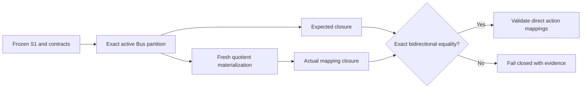

# PR-026 Stage 1: derived mapping closure design freeze

_Design for a separate adaptive replay remediation; no implementation or real-case execution is included._

---

## 🧭 Frozen baseline and decision

PR-025 Stage2B remains an authoritative failed experiment: `PR025_STAGE2B_EXECUTION = FAIL`, `STAGE2B_EXPERIMENT_OUTCOME = NOT_EXECUTED`, and `UNJOURNALED_MANY_TO_ONE_BRANCH_MAP_EFFECT`. Its [anonymous RCA](2026-11-02-pr025-stage2b-reconstruction-rca.md) identified 103 ordinary preexisting parallel groups containing 208 source Lines: 102 two-member groups and one four-member group. None was induced by one or multiple active Bus actions; none was an unrelated materializer aggregation. No protected or L+ identity was involved. The materializer produced a deterministic quotient effect; the adaptive validator correctly failed closed under an incomplete journal model. This design does not rewrite those results.

`ReductionAction.mapping_delta` remains the immutable record of direct effects owned by an action. A separate immutable `DerivedMappingClosure` records deterministic secondary branch effects of the *whole* active Bus partition. It is recomputed for every candidate from frozen S1, never assigned retroactively to one historical action. Existing direct-action validation stays mandatory.

## 🔍 Verified PyPSA 1.2.4 Line grouping contract

The current `QuotientMaterializer` invokes `n.cluster.spatial.get_clustering_from_busmap` through the public compatibility wrapper. In installed PyPSA **1.2.4**, `SpatialClusteringAccessor.get_clustering_from_busmap` calls `pypsa.clustering.spatial.aggregatelines` with the Bus map, `line_strategies`, and `custom_line_groupers`. Our current call supplies no custom Line groupers, so PyPSA uses `[]`.

The exact sequence in `aggregatelines` is:

1. Retain each static Line whose mapped `bus0` and `bus1` differ. This test does **not** filter on `active`.
2. Map both terminal Bus names, then swap the mapped names where `bus0 > bus1`; direction is normalized for grouping.
3. Form `static.groupby(["bus0", "bus1", *custom_line_groupers]).ngroup().astype(str)`. With the current empty custom list, the **only grouping key is the unordered mapped Bus pair** within the extracted voltage layer.
4. Aggregate static and dynamic attributes using strategies, returning the group label as `linemap` for surviving Lines.

`carrier`, `type`/LineType, `active`, electrical parameters, and dynamic attributes are **not** grouping keys in this call. They may affect aggregation strategy or electrical-equivalence eligibility, which is a separate check. Both active and inactive source Lines enter grouping unless a protection handler detached them first. The generated string group label and later layer-qualified target name are backend identities and must not enter closure identity. A future nonempty `custom_line_groupers` setting or different PyPSA grouping contract requires an explicit compatibility update; it must not be guessed.

The per-layer materializer removes protected Lines before the public quotient and reconnects them with source StableId identity afterward. PyPSA removes two-terminal Links whose mapped `bus0 == bus1` but does not group surviving Links. Transformers are preserved across layers with mandatory singleton terminals; a Transformer self-loop remains a hard error. Existing Line electrical materialization remains responsible for supported parallel-admittance equivalents and fails closed when it cannot construct one. The closure validates *mapping semantics*, not AC equivalence.

## 🧱 Contract and canonical representation

Stage 2 should add a backend-neutral immutable `DerivedMappingClosure` with schema `derived-mapping-closure/v1` and sorted `DerivedBranchEffect` rows. The supported effect types are:

| Effect | Expected source condition | Actual map condition |
| --- | --- | --- |
| `ABSORBED_INTERNAL` | A legally absorbable source Line or supported two-terminal, same-layer Link has both terminals mapped to one Bus | Exactly one `absorbed_internal` row, `target_id = None` |
| `MANY_TO_ONE_BRANCH_AGGREGATION` | At least two eligible ordinary Lines share the exact frozen Line grouping key after mapping | All and only those source Lines have `aggregated` rows to one existing target Line |

Transformer absorption and cross-component aggregation are never derivable. V1 does not model device many-to-one effects; any unjournaled such effect remains fail-closed. An action may also declare a transition that appears in the closure's branch scope: direct-action validation still checks its declaration, while closure equality checks the complete secondary topology consequence. This does not mutate or reassign ownership of `mapping_delta`.

Each effect's canonical payload contains schema, component type, effect type, sorted source StableIds, sorted mapped endpoint StableIds, canonical voltage layer, exact Line grouping-key values, policy/compatibility basis, and per-member protection and ledger eligibility. The Line grouping-key values in the current profile are only the mapped endpoint pair; `active` and LineType are eligibility or electrical-semantic data, never invented groupers. The closure header binds the frozen source model and sidecar digests, exact partition digest, semantic aggregation-policy digest, resolved-protection digest, protected-parallel-plan digest, explicit source-ledger digest, and the grouping-contract identifier `pypsa-1.2.4-line-endpoint-v1`.

Serialize this payload as versioned canonical JSON with stable key order, sorted effect rows, explicit types and finite numeric values; SHA-256 of those bytes is `derived_mapping_closure_digest`. The empty effect list has a deterministic digest for the same frozen basis. Backend target Line names, Python object identity, iteration order, paths, runtime measurements, and exception text are excluded. Private evidence may retain StableIds; public evidence exposes only deterministic effect fingerprints and aggregate counts.

## 🔁 Expected and actual closure

The expected closure is computed **before accepting** the final MappingBundle:

```text
frozen S1 + authoritative sidecar + exact active Bus partition
  + frozen aggregation policy + resolved protection
  + protected-parallel plan + explicit source ledger
  -> expected DerivedMappingClosure
```

Compute it separately per canonical voltage layer. First validate the Bus partition and all singleton/cannot-link rules. Remove every identity-preserved Line from the ordinary pool according to the effective protection union, protected-parallel policy, and L+ owner contract. Derive legal internal Line and supported two-terminal Link absorption from mapped terminals. For remaining Lines, apply the verified PyPSA 1.2.4 grouping rule, including inactive members, and emit a many-to-one effect only for groups of size at least two. A protected identity entering an aggregating group is an immediate hard error. Unsupported Link ports, control ownership, branch model, or equivalence stay subject to existing capability and structural Gates; the closure grants no new permission.



Normalize the actual `MappingBundle.branch_map` independently. For absorption, check source membership, effect type, and null target. For many-to-one effects, first group map rows by actual target StableId, verify that exactly one target Line exists in the materialized network and sidecar, and verify its actual terminals equal the expected mapped endpoint pair. Then discard that backend-derived target identity from the canonical effect. Reconstruct source membership and eligibility from the frozen source and partition. Singleton surviving Line mappings are outside the derived many-to-one set. Compare canonical expected and actual effect multisets **bidirectionally**, including exact source membership, component type, effect type, mapped endpoints, grouping basis, and policy eligibility. No unexpected or missing row is tolerated. `MappingBundle` source coverage, protected identity, electrical materialization, structural Gate, and AC readiness remain independent checks.

Preexisting ordinary parallel Lines are legal derived effects when policy permits, exact grouping matches, and no identity constraint applies; no synthetic action is needed. Formerly nonparallel Lines may also become one group after one or several Bus actions. After expansion/deactivation, reconstruct from frozen S1 and recompute the whole partition and closure; never patch the previous candidate or closure incrementally.

## 🛡️ Failure and replay semantics

Protection precedes derivation. `preserve_protected_members`, any future supported `preserve_all_members`, explicit component identity, protected-parallel membership, L+ base-Line/Shunt association, and other frozen preservation rules cannot be waived by a matching PyPSA `linemap`. A materializer violation is `UNAUTHORIZED_PROTECTED_BRANCH_AGGREGATION`, not a legal derived effect. The currently unimplemented `preserve_all_members` policy continues to raise `UnsupportedFeatureError` until separately implemented.

Use deterministic failure categories, with protected-identity violation checked first:

| Code | Meaning |
| --- | --- |
| `UNAUTHORIZED_PROTECTED_BRANCH_AGGREGATION` | An identity-preserved source branch entered an aggregating actual group |
| `DERIVED_CLOSURE_MEMBERSHIP_MISMATCH` | Expected and actual grouping basis match, but source member sets differ |
| `DERIVED_CLOSURE_MISSING_EFFECT` | An expected effect has no actual counterpart |
| `DERIVED_CLOSURE_UNEXPECTED_EFFECT` | An actual effect has no expected counterpart, including wrong effect type |

Persist the expected and actual closure payloads or content-addressed artifacts, both independently recomputable from persisted frozen inputs and mappings. Failure evidence records code, stage, expected/actual closure digests, and sorted anonymous offending effect fingerprints; raw exception strings are diagnostic only. A failed build keeps `materialized_candidate_fingerprint = null`. Replay reloads source, sidecar, protection, ledger, active action set, and persisted MappingBundle, recomputes both closures and digests, and rejects substitution or tampering. Direct `_validate_action_mapping()` remains in the acceptance path.

For a successful build, add `derived_mapping_closure_digest` to `CandidateBuildIdentity` and to a versioned candidate semantic fingerprint. Use `semantic_config_digest` there; retain `full_config_digest` separately for freeze/provenance, so path-only relocation does not change semantic identity. `build_attempt_fingerprint` remains based only on frozen pre-materialization inputs and the active set; it does **not** gain a materialization-derived digest. Candidate fingerprint, evidence, and replay bind the same closure digest. A replayed candidate must reproduce the active set, partition, expected closure, actual closure, closure digest, and candidate semantic identity exactly.

## 🧪 Required Stage 2 synthetic fixtures

| # | Fixture | Required outcome |
| ---: | --- | --- |
| 1 | Two preexisting ordinary parallel Lines | One legal two-member effect |
| 2 | Four preexisting ordinary parallel Lines | One legal four-member effect |
| 3 | One Bus action makes two formerly nonparallel Lines parallel | Closure changes deterministically |
| 4 | Actions `A→B` and `X→Y` jointly coalesce Lines `A–X` and `B–Y`; neither alone does | No per-action ownership; combined partition derives effect. If mandatory topology protection rejects a full network, exercise this at the partition/closure contract layer |
| 5 | Protected-parallel Lines | One-to-one identity; no derived group |
| 6 | L+ ledger-bound base Line and Shunt | Both identities and association preserved; no derived group |
| 7 | Materializer supplies an unpredicted many-to-one group | Fail closed as unexpected effect |
| 8 | Materializer omits a predicted group | Fail closed as missing effect |
| 9 | Deactivate one action from a partition-induced case | Rebuild from S1; closure and digest change deterministically |
| 10 | Fresh-process replay of identical frozen inputs | Same rows and digest; tampering fails |
| 11 | No derived effects | Deterministic canonical empty-closure digest |
| 12 | Permute source/map row order | Identical closure digest |

Add focused checks that different `carrier`, LineType, `active`, or Line orientation do **not** silently become grouping keys under this frozen PyPSA contract, while existing protection and electrical Gates continue to decide whether the resulting equivalent is admissible. Device many-to-one remains a separate fail-closed case.

## 📌 Future compatibility and release gates

After Stage 2 implementation, a **read-only compatibility diagnostic** may reconstruct the frozen failed Stage2B starting state using its 125-action partition, before any PF/controller call. It must find exactly 103 expected and actual ordinary many-to-one groups, 208 source Lines, 102 pairs and one four-member group, zero protected/L+ identities, and exact closure equality, unless a documented exact backend-contract finding justifies a changed count. This diagnostic does not replace or overwrite the failed Stage2B result and is not a new Beijing acceptance.

The remediation version proposal is `0.8.0`; Stage 1 leaves package `0.7.0` unchanged. Once PR-026 is implemented, validated, and merged, any new Beijing execution needs a new identity, preferably **Stage2C**, with a new implementation commit, package version, identity/readiness freeze, and execution freeze. It may reuse the same physical S1 and frozen thresholds only after independent binding. Projection fidelity remains `NOT VALIDATED`; physical equivalence remains `NOT CLAIMED`.
