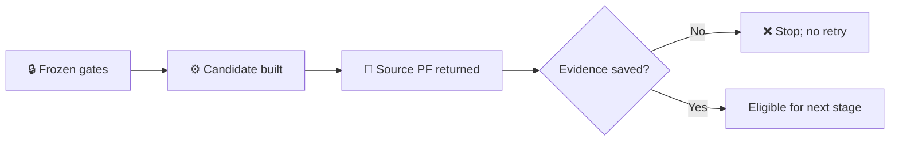

# Beijing retained-network fidelity execution stop

_Experiment: `BEIJING_RETAINED_NETWORK_FIDELITY_V1` · 2026-11-03_

---

## 📋 Summary

- The frozen source, parser manifest, locked Python 3.11 environment, threshold artifact, and BACKBONE_500 policy identity matched their frozen digests.
- BACKBONE_500 candidate construction completed with `MULTI_VOLTAGE_QUOTIENT_STRUCTURALLY_VALID` and `AC_MODEL_READY`.
- The source PF executor returned a result object, but the private evidence driver failed before saving that result. Its convergence state and numeric outputs are therefore unknown and cannot be reported.
- Per the experiment stop rule, no candidate PF, fidelity evaluation, replay, or later policy was started. No retry was performed.

## 🔎 Verified execution state

| Gate or artifact | Result |
| --- | --- |
| Frozen implementation baseline | `30d8c3e2cb75732a8e2fe151d1fd50ea3319344c` / `a40d8623dcee5e1004603b95cb93afc9790823de` |
| Freeze evidence | `741a6e9f7411176b321e6becd51749bcbc6ffa16` / `5edb132b158953ef21580d5ecb5d52df70151dc3` |
| Environment | Python `3.11.15`; PyPSA `1.2.4`; locked environment gate passed |
| Source/parser identity gates | Passed; frozen source model, sidecar, ledger, protection, and parser manifest digests matched |
| Frozen threshold artifact | `PR022_AC_PF_FIDELITY_V1`; SHA-256 matched; unchanged |
| BACKBONE_500 candidate construction | Completed; 1,527 source Bus, 639 source Line, 1,344 source Transformer rows; 1,392 candidate Bus, 399 candidate Line, 1,344 candidate Transformer rows |
| Structural Gate | `MULTI_VOLTAGE_QUOTIENT_STRUCTURALLY_VALID` |
| AC readiness | `AC_MODEL_READY` |
| Source PF | One solver invocation; result object returned, but numerical status and values were not captured |
| Candidate PF / fidelity / replay | `NOT_RUN` |
| BACKBONE_220 / BACKBONE_100 | `NOT_RUN` |

## ⚠️ Stop reason

The local evidence driver tried to read `PowerFlowSubnetworkStatus.ordinal`. The result contract names that field `subnetwork_ordinal`. The attribute error occurred after the source PF executor returned and before the driver wrote any source PF payload. Consequently, solver convergence, per-subnetwork iterations and errors, source solver timing, resolved cutset thresholds, and comparison metrics are unavailable.

This is an execution-evidence capture failure, not evidence of PF convergence or nonconvergence. Retrying would create another solve and would not recover the missing first result. The frozen procedure requires stopping on evidence-integrity failure, so the candidate PF and remaining policies were not run.

## 🧾 Evidence and claim boundary

The source/candidate networks, sidecars, maps, structural reports, and other identity-bearing artifacts remain in the private run area. This committed record contains only anonymous execution status and approved digest references. No raw model, device identity, StableId, source card, PF array, or local filesystem path is included.

Historical Stage2A, Stage2B, and Stage2C evidence were not overwritten. Implementation code, the frozen threshold definition, and adaptive controller were not changed or run.

`Projection fidelity = NOT VALIDATED`

`Physical equivalence = NOT CLAIMED`

## ➡️ Next step

Review the STOP evidence. Any resumed experiment should use a corrected evidence driver and a new, explicitly identified execution attempt; this record must remain unchanged.
